# Project 3: Serverless Contact Form with Lambda and SES

# Project 3: Serverless Contact Form with AWS Lambda and Amazon SES

## Overview


Your company's website needs a contact form that users can submit. Instead of managing servers, this project builds a serverless solution that automatically sends emails to your support team. A static HTML contact form submits data to AWS Lambda via API Gateway, and Lambda validates the input and sends the email using Amazon SES.
A high-performance, cost-optimized, and fully serverless contact form backend built on Amazon Web Services (AWS). This project eliminates the operational overhead of managing physical or virtual servers by combining **Amazon API Gateway**, **AWS Lambda**, and **Amazon Simple Email Service (SES)** to deliver automated email notifications from website visitors directly to a support inbox.

## Prerequisites

---

Before starting this project, ensure you have:

## Table of Contents

1. An AWS account with Lambda, API Gateway, and SES permissions
2. AWS CLI installed and configured
3. Node.js installed locally (for packaging Lambda code)
4. A verified email address in Amazon SES (sandbox mode is fine for testing)
5. Basic understanding of HTTP APIs and email services

- [1. Project Overview](#1-project-overview)
- [2. Architecture Diagram](#2-architecture-diagram)
- [3. Architecture Workflow](#3-architecture-workflow)
- [4. AWS Services Used](#4-aws-services-used)
- [5. Features](#5-features)
- [6. Prerequisites](#6-prerequisites)
- [7. Project Structure](#7-project-structure)
- [8. Step-by-Step AWS Implementation](#8-step-by-step-aws-implementation)
  - [8.1 Amazon SES Email Verification](#81-amazon-ses-email-verification)
  - [8.2 IAM Role and Policy Configuration](#82-iam-role-and-policy-configuration)
  - [8.3 Lambda Function Creation and Code Deployment](#83-lambda-function-creation-and-code-deployment)
  - [8.4 Lambda Environment Variables Configuration](#84-lambda-environment-variables-configuration)
  - [8.5 Amazon API Gateway REST API Creation](#85-amazon-api-gateway-rest-api-creation)
  - [8.6 Resource and POST Method Setup (Lambda Proxy Integration)](#86-resource-and-post-method-setup-lambda-proxy-integration)
  - [8.7 Cross-Origin Resource Sharing (CORS) Configuration](#87-cross-origin-resource-sharing-cors-configuration)
  - [8.8 API Gateway Deployment to `prod` Stage](#88-api-gateway-deployment-to-prod-stage)
- [9. Frontend Configuration](#9-frontend-configuration)
- [10. Testing the API](#10-testing-the-api)
- [11. Email Delivery Verification](#11-email-delivery-verification)
- [12. CloudWatch Monitoring &amp; Metrics](#12-cloudwatch-monitoring--metrics)
- [13. AWS Deployment Screenshots](#13-aws-deployment-screenshots)
- [14. Troubleshooting](#14-troubleshooting)
- [15. Security Considerations](#15-security-considerations)
- [16. Cleanup Instructions](#16-cleanup-instructions)
- [17. Learning Outcomes](#17-learning-outcomes)
- [18. Author Information](#18-author-information)

---

## 1. Project Overview

In traditional web hosting architectures, handling a contact form requires provisioning virtual machines (e.g., EC2 instances), configuring web servers (e.g., NGINX, Apache), patching runtimes, maintaining SMTP email daemons (such as Postfix or Sendmail), and managing scaling policies. This approach introduces continuous maintenance, security vulnerabilities, and idle computing costs.

This project delivers a **100% serverless contact form backend** designed to:

- **Eliminate Server Management**: Compute runs strictly on-demand using AWS Lambda.
- **Scale Seamlessly**: API Gateway and Lambda automatically scale from zero to thousands of concurrent requests.
- **Ensure Enterprise-Grade Security**: Strict IAM least-privilege policies protect against unauthorized access, while input escaping prevents HTML injection and email spoofing.
- **Minimize Costs**: The architecture operates entirely within the AWS Free Tier during normal workloads, incurring zero idle runtime fees.

### Deployment Summary

| Parameter                       | Configuration Value                                                      |
| :------------------------------ | :----------------------------------------------------------------------- |
| **AWS Region**            | `eu-north-1` (Europe – Stockholm)                                     |
| **API Gateway Name**      | `ContactFormAPI`                                                       |
| **API Gateway ID**        | `jw0o1ts2t2`                                                           |
| **API Gateway Stage**     | `prod`                                                                 |
| **API Deployment ID**     | `s7sw79`                                                               |
| **Invoke URL**            | `https://jw0o1ts2t2.execute-api.eu-north-1.amazonaws.com/prod`         |
| **Full Contact Endpoint** | `https://jw0o1ts2t2.execute-api.eu-north-1.amazonaws.com/prod/contact` |
| **Lambda Function**       | `ContactFormHandler`                                                   |
| **Runtime**               | `Node.js 18.x` (AWS SDK v3)                                            |
| **IAM Execution Role**    | `ContactFormLambdaRole`                                                |
| **IAM Inline Policy**     | `SESSendPolicy`                                                        |
| **Email Service**         | Amazon Simple Email Service (SES)                                        |

---

## 2. Architecture Diagram


---

## 3. Architecture Workflow

The end-to-end request and response lifecycle executes across decoupled services:

```
User ──► Static Frontend ──► API Gateway (/contact) ──► AWS Lambda ──► Amazon SES ──► Support Inbox
          (contact.html)        (POST Method)        (index.js)        (Email)       (Gmail)
```

### 1. Request Lifecycle

1. **User Interaction**: The website user enters their name, email, subject, and message in `frontend/contact.html` and clicks **Send Message**.
2. **Client-Side Validation**: The frontend validates input integrity using standard HTML5 attributes and JavaScript logic.
3. **HTTP Dispatch**: An asynchronous `fetch()` call sends an `HTTP POST` request containing a JSON body to `https://jw0o1ts2t2.execute-api.eu-north-1.amazonaws.com/prod/contact`.
4. **API Gateway Ingestion**: Amazon API Gateway matches the `/contact` route, validates CORS preflight via an `OPTIONS` mock integration, and routes the request to AWS Lambda via **Lambda Proxy Integration**.
5. **Lambda Event Processing**: AWS Lambda unpacks `event.body`, inspects the payload, validates the email regex, and sanitizes strings using `escapeHtml()` to guard against cross-site scripting (XSS) and injection attacks.
6. **SES Dispatch**: Lambda issues an AWS SDK v3 `SendEmailCommand` to Amazon SES in `eu-north-1` using credentials assumed via the `ContactFormLambdaRole`.
7. **Email Delivery**: Amazon SES delivers both a plaintext and an HTML-formatted message to the destination inbox (`agsvwimalasiri@gmail.com`).

### 2. Response Lifecycle

1. **Lambda Output**: Lambda formats a strict HTTP response payload containing `statusCode: 200`, `headers` with `Access-Control-Allow-Origin: *`, and a JSON body with `success: true`.
2. **API Gateway Relay**: API Gateway passes the Lambda response headers and body directly back to the calling browser without payload alteration.
3. **UI Confirmation**: The frontend JavaScript parses the JSON response, clears the input fields, and displays a green success confirmation message to the user.

---

## 4. AWS Services Used

| Service                      | Primary Purpose in Architecture                                                  | Configuration Highlights                                                                                              |
| :--------------------------- | :------------------------------------------------------------------------------- | :-------------------------------------------------------------------------------------------------------------------- |
| **Amazon API Gateway** | Provides a secure, public HTTPS REST endpoint for the frontend client.           | REST API with `/contact` resource, `POST` method (Lambda Proxy Integration), and `OPTIONS` CORS mock preflight. |
| **AWS Lambda**         | Executes backend business logic, sanitizes input, and invokes the email command. | Function: `ContactFormHandler`, Runtime: Node.js 18.x, Memory: 128 MB, Timeout: 30s.                                |
| **Amazon SES**         | Handles reliable outbound email generation and SMTP delivery.                    | Region: `eu-north-1` (Stockholm), Sender & Recipient verified under Sandbox constraints.                            |
| **AWS IAM**            | Grants fine-grained execution permissions to the Lambda function.                | Role: `ContactFormLambdaRole`, Policies: `AWSLambdaBasicExecutionRole` + custom `SESSendPolicy`.                |
| **Amazon CloudWatch**  | Ingests execution logs, tracks latency, cold starts, and function metrics.       | Log Group `/aws/lambda/ContactFormHandler`, Invocations, Duration, and Error Rate metrics.                          |

---

## 5. Features

- **True Serverless Architecture**: Zero EC2 instances or long-running virtual machines to provision or manage.
- **AWS SDK v3 Integration**: Uses modern, modular `@aws-sdk/client-ses` for fast execution and minimal bundle size.
- **Robust Security & Sanitation**: Custom `escapeHtml()` helper prevents HTML injection inside generated email notifications.
- **Lambda Proxy Integration**: Ensures dynamic HTTP status codes (`200`, `400`, `500`) and comprehensive response headers.
- **Complete CORS Implementation**: Full support for preflight `OPTIONS` requests enabling cross-origin requests from any static domain or CDN.
- **Dual Email Templates**: Delivers both responsive, styled HTML templates and accessible plaintext fallbacks.
- **Production Observability**: Full execution tracking and performance telemetry via Amazon CloudWatch metrics and log streams.

---

## 6. Prerequisites

Before deploying or running this project, ensure you have:

1. **AWS Account**: An active AWS account with permissions for API Gateway, Lambda, IAM, SES, and CloudWatch.
2. **AWS CLI v2**: Installed and configured locally (`aws configure`) with access to region `eu-north-1`.
3. **Node.js 18.x or later**: Installed for local testing and dependency management.
4. **Verified Email Address**: Access to an email address to verify in Amazon SES (required for both sender and recipient in SES Sandbox).
5. **Modern Web Browser**: For running and testing the static contact form.

---

## 7. Project Structure

```text
AWS Project 3 - Serverless Contact Form/
├── frontend/
│   └── contact.html           # Responsive HTML5/CSS3/JavaScript contact form UI
├── lambda/
│   ├── index.js        # Lambda handler
│   └── package.json    # Node.js dependencies
├── frontend/
│   └── contact.html    # Contact form page
├── deploy.sh           # Automated deployment script
└── README.md
│   ├── index.js               # Core Lambda function handler with input validation & SES dispatch
│   └── package.json           # Node.js project manifest & @aws-sdk/client-ses dependency
├── screenshots/               # Deployment visual evidence captured from AWS Management Console
│   ├── 1.png                  # SES Sandbox overview in eu-north-1
│   ├── 1.1.png                # SES email address verification confirmation
│   ├── 2.png                  # IAM role ContactFormLambdaRole creation
│   ├── 3.png                  # IAM role policies (AWSLambdaBasicExecutionRole & SESSendPolicy)
│   ├── 4.png                  # Lambda function ContactFormHandler creation overview
│   ├── 5.png                  # Lambda environment variables (SENDER_EMAIL, RECIPIENT_EMAIL)
│   ├── 6.png                  # Lambda code editor and source deployment
│   ├── 7.png                  # Lambda test execution output and error handling
│   ├── 8.png                  # API Gateway ContactFormAPI creation
│   ├── 9.png                  # API Gateway /contact resource creation
│   ├── 10.png                 # API Gateway POST method Lambda Proxy Integration execution diagram
│   ├── 11.png                 # API Gateway resources and CORS OPTIONS method overview
│   ├── 12.png                 # API Gateway prod stage deployment and invoke URL
│   ├── 13.png                 # Frontend contact form UI populated with test data
│   ├── 14.png                 # Delivery verification: HTML email received in Gmail inbox
│   ├── 15.png                 # CloudWatch metrics (Invocations, Duration, Success Rate)
│   └── Serverless Contact Form Architecture.png # Architectural workflow overview diagram
├── deploy.sh                  # Shell script for automated AWS CLI deployment
└── README.md                  # Comprehensive project documentation
```

## Steps

---

### 1. Verify Email in Amazon SES

## 8. Step-by-Step AWS Implementation

1. Open the SES Console and navigate to Verified identities.
2. Click Create identity and select Email address.
3. Enter the email address that will send and receive form submissions (for example, `you@example.com`).
4. Click Create identity.
5. Check your inbox for a verification link from AWS and click it.
   Follow these step-by-step instructions to recreate this architecture from scratch using the AWS Management Console or the AWS CLI.

> In sandbox mode, both the sender and recipient addresses must be verified. Request production access when you are ready to send to arbitrary recipients.

### 8.1 Amazon SES Email Verification

### 2. Create IAM Role for Lambda

Amazon SES starts in **Sandbox Mode** in all regions. In sandbox mode:

- You can send a maximum of 200 emails per 24-hour period.
- Sending rate is capped at 1 email per second.
- **Both sender and recipient email addresses must be explicitly verified identities.**

Create a trust policy allowing Lambda to assume the role, then attach the required policies:

#### Console Steps:

1. Navigate to **Amazon SES** in the AWS Console and set the region to **Europe (Stockholm) `eu-north-1`**.
2. In the left navigation pane, under **Configuration**, select **Identities**.
3. Click **Create identity**.
4. Select **Email address** and enter the email (e.g., `agsvwimalasiri@gmail.com`).
5. Click **Create identity**.
6. Open your email inbox, find the automated verification email from Amazon Web Services, and click the confirmation link.
7. The status in the SES console will update from `Verification pending` to `Verified`.

#### AWS CLI Alternative:

```bash
cat > lambda-trust-policy.json << 'EOF'
aws ses verify-email-identity \
  --email-address agsvwimalasiri@gmail.com \
  --region eu-north-1
```

---

### 8.2 IAM Role and Policy Configuration

Lambda requires execution permissions to write logs to CloudWatch and call the Amazon SES `SendEmail` and `SendRawEmail` APIs.

#### 1. Trust Policy (`lambda-trust-policy.json`):

```json
{
  "Version": "2012-10-17",
  "Statement": [{
    "Effect": "Allow",
    "Principal": {"Service": "lambda.amazonaws.com"},
    "Action": "sts:AssumeRole"
  }]
  "Statement": [
    {
      "Effect": "Allow",
      "Principal": {
        "Service": "lambda.amazonaws.com"
      },
      "Action": "sts:AssumeRole"
    }
  ]
}
EOF
```

#### 2. SES Permissions Policy (`ses-policy.json`):

```json
{
  "Version": "2012-10-17",
  "Statement": [
    {
      "Effect": "Allow",
      "Action": [
        "ses:SendEmail",
        "ses:SendRawEmail"
      ],
      "Resource": "*"
    }
  ]
}
```

#### AWS CLI Setup:

```bash
# 1. Create the IAM Role
aws iam create-role \
  --role-name ContactFormLambdaRole \
  --assume-role-policy-document file://lambda-trust-policy.json

# 2. Attach AWS managed basic execution role (CloudWatch logging)
aws iam attach-role-policy \
  --role-name ContactFormLambdaRole \
  --policy-arn arn:aws:iam::aws:policy/service-role/AWSLambdaBasicExecutionRole

cat > ses-send-policy.json << 'EOF'
{
  "Version": "2012-10-17",
  "Statement": [{
    "Effect": "Allow",
    "Action": ["ses:SendEmail", "ses:SendRawEmail"],
    "Resource": "*"
  }]
}
EOF

# 3. Create and attach custom inline policy for Amazon SES
aws iam put-role-policy \
  --role-name ContactFormLambdaRole \
  --policy-name SESSendPolicy \
  --policy-document file://ses-send-policy.json
  --policy-document file://ses-policy.json
```

### 3. Deploy the Lambda Function

---

### 8.3 Lambda Function Creation and Code Deployment

1. Navigate to **AWS Lambda** in `eu-north-1`.
2. Click **Create function** with the following settings:
   - **Function name**: `ContactFormHandler`
   - **Runtime**: `Node.js 18.x`
   - **Architecture**: `x86_64`
   - **Execution role**: Choose *Use an existing role*, and select `ContactFormLambdaRole`.
3. In the **Code Source** tab, package or paste the function code from `lambda/index.js`.
4. Click **Deploy**.

#### Packaging and Deploying via AWS CLI:

```bash
cd lambda
zip -r ../function.zip index.js
zip -r ../function.zip index.js package.json
cd ..

ROLE_ARN=$(aws iam get-role --role-name ContactFormLambdaRole --query 'Role.Arn' --output text)

aws lambda create-function \
  --function-name ContactFormHandler \
  --runtime nodejs18.x \
  --role "$ROLE_ARN" \
  --handler index.handler \
  --zip-file fileb://function.zip \
  --timeout 30 \
  --environment Variables="{SENDER_EMAIL=you@example.com,RECIPIENT_EMAIL=you@example.com}"
  --memory-size 128 \
  --region eu-north-1
```

To update the function code after changes:
------------------------------------------

### 8.4 Lambda Environment Variables Configuration

The Lambda function reads both the sender and recipient addresses securely from environment variables, preventing hardcoded credentials in the repository code:

1. In the Lambda function console, select the **Configuration** tab.
2. Select **Environment variables** from the sidebar and click **Edit**.
3. Add the following key-value pairs:
   - `SENDER_EMAIL`: `agsvwimalasiri@gmail.com`
   - `RECIPIENT_EMAIL`: `agsvwimalasiri@gmail.com`
4. Click **Save**.

```bash
cd lambda
zip -r ../function.zip index.js
cd ..

aws lambda update-function-code \
aws lambda update-function-configuration \
  --function-name ContactFormHandler \
  --zip-file fileb://function.zip
  --environment "Variables={SENDER_EMAIL=agsvwimalasiri@gmail.com,RECIPIENT_EMAIL=agsvwimalasiri@gmail.com}" \
  --region eu-north-1
```

### 4. Create API Gateway Endpoint

---

```bash
REGION=$(aws configure get region)
ACCOUNT_ID=$(aws sts get-caller-identity --query Account --output text)
### 8.5 Amazon API Gateway REST API Creation

API_ID=$(aws apigateway create-rest-api \
  --name ContactFormAPI \
  --description "Contact form API" \
  --query 'id' \
  --output text)
1. Navigate to **API Gateway** in `eu-north-1`.
2. Click **Create API** and select **REST API** (Click *Build*).
3. Select **New API**.
4. Configure API details:
   - **API name**: `ContactFormAPI`
   - **Description**: `Serverless contact form API`
   - **Endpoint Type**: `Regional`
5. Click **Create API**. (Assigned API ID: `jw0o1ts2t2`).

ROOT_ID=$(aws apigateway get-resources \
  --rest-api-id $API_ID \
  --query 'items[0].id' \
  --output text)
---

RESOURCE_ID=$(aws apigateway create-resource \
  --rest-api-id $API_ID \
  --parent-id $ROOT_ID \
  --path-part contact \
  --query 'id' \
  --output text)
### 8.6 Resource and POST Method Setup (Lambda Proxy Integration)

# Create POST and OPTIONS methods
aws apigateway put-method \
  --rest-api-id $API_ID \
  --resource-id $RESOURCE_ID \
  --http-method POST \
  --authorization-type NONE
1. Under **Resources**, click **Create resource**.
2. Set **Resource path**: `/`
3. Set **Resource name**: `contact`
4. Path becomes `/contact` (Resource ID: `rgmghx`). Click **Create resource**.
5. With `/contact` selected, click **Create method**.
6. Set **Method type**: `POST`.
7. Set **Integration type**: `Lambda function`.
8. Check **Lambda proxy integration** (crucial for passing raw headers, paths, and JSON bodies).
9. Select **Lambda region**: `eu-north-1`.
10. Select **Lambda Function**: `ContactFormHandler`.
11. Click **Create method** and grant API Gateway permission to invoke the function.

aws apigateway put-method \
  --rest-api-id $API_ID \
  --resource-id $RESOURCE_ID \
  --http-method OPTIONS \
  --authorization-type NONE
---

LAMBDA_ARN=$(aws lambda get-function --function-name ContactFormHandler --query 'Configuration.FunctionArn' --output text)
### 8.7 Cross-Origin Resource Sharing (CORS) Configuration

# Lambda proxy integration for POST
aws apigateway put-integration \
  --rest-api-id $API_ID \
  --resource-id $RESOURCE_ID \
  --http-method POST \
  --type AWS_PROXY \
  --integration-http-method POST \
  --uri "arn:aws:apigateway:$REGION:lambda:path/2015-03-31/functions/$LAMBDA_ARN/invocations"
Because web browsers enforce the Same-Origin Policy, requests originating from a static web domain or local file require CORS headers:

# MOCK integration for CORS preflight
aws apigateway put-integration \
  --rest-api-id $API_ID \
  --resource-id $RESOURCE_ID \
  --http-method OPTIONS \
  --type MOCK \
  --request-templates '{"application/json": "{\"statusCode\": 200}"}'
1. Select the `/contact` resource.
2. Click **Enable CORS**.
3. Configure the CORS preflight settings:
   - **Access-Control-Allow-Methods**: `POST, OPTIONS`
   - **Access-Control-Allow-Headers**: `'Content-Type,X-Amz-Date,Authorization,X-Api-Key,X-Amz-Security-Token'`
   - **Access-Control-Allow-Origin**: `'*'`
4. Click **Save**. API Gateway automatically generates an `OPTIONS` method with a `Mock` integration returning the preflight headers.

aws apigateway put-method-response \
  --rest-api-id $API_ID \
  --resource-id $RESOURCE_ID \
  --http-method OPTIONS \
  --status-code 200 \
  --response-parameters '{"method.response.header.Access-Control-Allow-Headers": true, "method.response.header.Access-Control-Allow-Methods": true, "method.response.header.Access-Control-Allow-Origin": true}'
---

aws apigateway put-integration-response \
  --rest-api-id $API_ID \
  --resource-id $RESOURCE_ID \
  --http-method OPTIONS \
  --status-code 200 \
  --response-parameters '{"method.response.header.Access-Control-Allow-Headers": "'\''Content-Type,X-Amz-Date,Authorization,X-Api-Key,X-Amz-Security-Token'\''", "method.response.header.Access-Control-Allow-Methods": "'\''POST,OPTIONS'\''", "method.response.header.Access-Control-Allow-Origin": "'\''*'\''"}'
### 8.8 API Gateway Deployment to `prod` Stage

# Grant API Gateway permission to invoke Lambda
aws lambda add-permission \
  --function-name ContactFormHandler \
  --statement-id apigateway-invoke \
  --action lambda:InvokeFunction \
  --principal apigateway.amazonaws.com \
  --source-arn "arn:aws:execute-api:$REGION:$ACCOUNT_ID:$API_ID/*/*/contact"
1. Click the **Deploy API** button at the top right of the API Gateway console.
2. In the modal:
   - **Stage**: Select *[New Stage]*.
   - **Stage name**: `prod`
   - **Deployment description**: `Production deployment for contact form backend`.
3. Click **Deploy**.
4. The deployment generates the base **Invoke URL**:
```

   https://jw0o1ts2t2.execute-api.eu-north-1.amazonaws.com/prod

```
5. The full endpoint for form submissions is:
```

   https://jw0o1ts2t2.execute-api.eu-north-1.amazonaws.com/prod/contact

```

aws apigateway create-deployment \
  --rest-api-id $API_ID \
  --stage-name prod
---

API_ENDPOINT="https://$API_ID.execute-api.$REGION.amazonaws.com/prod/contact"
echo "API Endpoint: $API_ENDPOINT"
```

## 9. Frontend Configuration

### 5. Configure the Frontend

The frontend consists of a standalone, responsive interface built with clean HTML5, CSS3, and vanilla JavaScript in `frontend/contact.html`.

Open `frontend/contact.html` and replace the placeholder value:

### Key Configuration

In `frontend/contact.html` (line 198), ensure the `API_ENDPOINT` constant points to your deployed API Gateway stage:

```javascript
// AWS API Gateway endpoint
const API_ENDPOINT = 'https://jw0o1ts2t2.execute-api.eu-north-1.amazonaws.com/prod/contact';
```

YOUR_API_GATEWAY_ENDPOINT_HERE

```

with the value of `$API_ENDPOINT` printed in the previous step. If you used `deploy.sh`, this substitution is done automatically.
### Form Submission Handler
The form intercepts the browser's default submit event, prepares a JSON payload, disables the button to prevent duplicate submissions, and issues an asynchronous `fetch()` call:

### 6. Test the Application
```javascript
form.addEventListener('submit', async function (event) {
    event.preventDefault();

Submit a test request via curl:
    const payload = {
        name: document.getElementById('name').value.trim(),
        email: document.getElementById('email').value.trim(),
        subject: document.getElementById('subject').value.trim(),
        message: document.getElementById('messageInput').value.trim()
    };

```bash
curl -X POST "$API_ENDPOINT" \
  -H "Content-Type: application/json" \
  -d '{"name":"Test User","email":"test@example.com","message":"Hello from Project 3"}'
    submitBtn.disabled = true;
    submitBtn.textContent = 'Sending...';

    try {
        const response = await fetch(API_ENDPOINT, {
            method: 'POST',
            headers: { 'Content-Type': 'application/json' },
            body: JSON.stringify(payload)
        });

        const result = await response.json();
        if (response.ok && result.success) {
            showMessage('success', result.message || 'Your message was sent successfully!');
            form.reset();
        } else {
            throw new Error(result.message || 'Failed to send message.');
        }
    } catch (error) {
        showMessage('error', error.message || 'Network error occurred.');
    } finally {
        submitBtn.disabled = false;
        submitBtn.textContent = 'Send Message';
    }
});
```

You should receive a JSON response with `"success": true` and find a new email in your inbox.
----------------------------------------------------------------------------

## Console Deployment

## 10. Testing the API

### 1. Verify Email in Amazon SES

### Method 1: Testing via cURL (Command Line)

1. Go to **AWS Console → SES → Verified identities**
2. Click **Create identity** → select **Email address**
3. Enter your email address → click **Create identity**
4. Check your inbox for a verification email from AWS and click the link
   Execute an HTTP POST request to test the full pipeline independently of the web frontend:

> **Note:** In SES sandbox mode both the sender and recipient addresses must be verified.

```bash
curl -X POST https://jw0o1ts2t2.execute-api.eu-north-1.amazonaws.com/prod/contact \
  -H "Content-Type: application/json" \
  -d '{
    "name": "Sandeepa Wimalasiri",
    "email": "agsvwimalasiri@gmail.com",
    "subject": "Test Message via cURL",
    "message": "This is a direct API verification test."
  }'
```

### 2. Create IAM Role for Lambda

#### Expected 200 OK Response:

```json
{
  "success": true,
  "message": "Email sent successfully!",
  "messageId": "0109019339e70195-2c81da53-f72b-4177-885f-33d3c8c72cfb-000000"
}
```

1. Go to **IAM → Roles → Create role**
2. **Trusted entity type:** AWS service → **Use case:** Lambda → click **Next**
3. Search and attach **AWSLambdaBasicExecutionRole** → click **Next**
4. **Role name:** `ContactFormLambdaRole` → click **Create role**
5. Open the role → **Add permissions → Create inline policy** → switch to **JSON** tab and paste:

### Method 2: Testing via Postman / REST Client

1. Set HTTP Method to `POST`.
2. Enter URL: `https://jw0o1ts2t2.execute-api.eu-north-1.amazonaws.com/prod/contact`.
3. Set Header: `Content-Type: application/json`.
4. Enter JSON Body:
   ```json
   {
     "Version": "2012-10-17",
     "Statement": [{
       "Effect": "Allow",
       "Action": ["ses:SendEmail", "ses:SendRawEmail"],
       "Resource": "*"
     }]
     "name": "Sandeepa Wimalasiri",
     "email": "agsvwimalasiri@gmail.com",
     "message": "Hello from Postman!"
   }
   ```
5. **Policy name:** `SESSendPolicy` → click **Create policy**
6. Click **Send** and verify HTTP status `200 OK`.

### 3. Create the Lambda Function

### Method 3: Browser Form Submission

Open `frontend/contact.html` directly in any web browser, fill in the fields, and click **Send Message**.

1. Go to **Lambda → Create function → Author from scratch**
   - **Function name:** `ContactFormHandler`
   - **Runtime:** Node.js 16.x
2. Under **Permissions → Change default execution role** → **Use an existing role** → select `ContactFormLambdaRole`
3. Click **Create function**
4. In the **Code source** editor, delete the default code and paste the full contents of `lambda/index.js`
5. Click **Deploy**
6. Click **Configuration → Environment variables → Edit** and add:
   - `SENDER_EMAIL` = your verified email
   - `RECIPIENT_EMAIL` = your verified email
7. Click **Save**

---

### 4. Create API Gateway

## 11. Email Delivery Verification

1. Go to **API Gateway → Create API → REST API** (not private) → click **Build**
2. **API name:** `ContactFormAPI` → click **Create API**
3. Click **Create resource** → **Resource name:** `contact` → check **CORS** → click **Create resource**
4. With `/contact` selected, click **Create method**
   - **Method type:** POST | **Integration type:** Lambda function | **Lambda proxy integration:** ON
   - **Lambda function:** `ContactFormHandler` → click **Create method** → click **OK** to grant permission
5. With `/contact` selected, click **Enable CORS** → check POST and OPTIONS → click **Save**
   Upon successful submission, the message is processed and dispatched by Amazon SES. As captured in the Gmail inbox evidence:

### 5. Deploy the API

- **Sender**: `agsvwimalasiri@gmail.com via amazonses.com`
- **Subject**: `Contact Form: hello`
- **Recipient**: Verified recipient address
- **Delivery Header**: Cryptographically authenticated via Amazon SES SPF and DKIM.
- **Message Content**: Displays structured name, email hyperlink, ISO timestamp, and sanitized message text within an HTML template.

1. Click **Deploy API** (top right) → **Stage:** `[New stage]` → **Stage name:** `prod` → click **Deploy**
2. Copy the **Invoke URL** — your full contact endpoint is `<Invoke URL>/contact`
3. Open `frontend/contact.html` and replace `YOUR_API_GATEWAY_ENDPOINT_HERE` with your endpoint URL

---

### Console Cleanup

## 12. CloudWatch Monitoring & Metrics

1. **API Gateway** → select `ContactFormAPI` → **Actions → Delete API**
2. **Lambda** → select `ContactFormHandler` → **Actions → Delete**
3. **IAM → Roles** → delete `ContactFormLambdaRole` (detach/delete policies first)
4. **SES → Verified identities** → delete your verified email identity
   Every request routed to AWS Lambda automatically produces diagnostic logs and performance telemetry in **Amazon CloudWatch**:

- **Log Group**: `/aws/lambda/ContactFormHandler`
- **Observed Metrics**:
  - **Invocations**: 5 total invocations tracked during development and validation.
  - **Execution Duration**:
    - Minimum duration: `90.13 ms`
    - Average duration: `442.00 ms`
    - Maximum duration: `882.14 ms` (cold start)
  - **Error Rate & Success Rate**: Early validation test returned expected 500 error on invalid test event, followed by a rapid recovery to a **100% success rate**.

---

## CLI / Automation

## 13. AWS Deployment Screenshots

Use `deploy.sh` to perform all of the above steps automatically:
The following screenshots provide verified documentation evidence of the AWS infrastructure, configuration settings, and application behavior:

```bash
# Edit SENDER_EMAIL and RECIPIENT_EMAIL in deploy.sh first
chmod +x deploy.sh
./deploy.sh
```

### Category 1: Architecture Reference

The script packages `lambda/index.js`, creates the IAM role, deploys the Lambda function, creates and configures API Gateway with CORS, and updates `frontend/contact.html` with the live endpoint.

#### Architectural Overview

Complete flow diagram illustrating request travel from client to Amazon SES, including key architectural benefits and flow summary.


## Monitoring

---

Stream Lambda logs to your terminal:

### Category 2: Amazon SES Email Verification

#### SES Sandbox Overview in `eu-north-1`

Displays the Amazon SES console dashboard in Europe (Stockholm), showing Sandbox status (200 emails per 24 hours, 1 email/sec max rate), test email tools, and domain identity verification status.
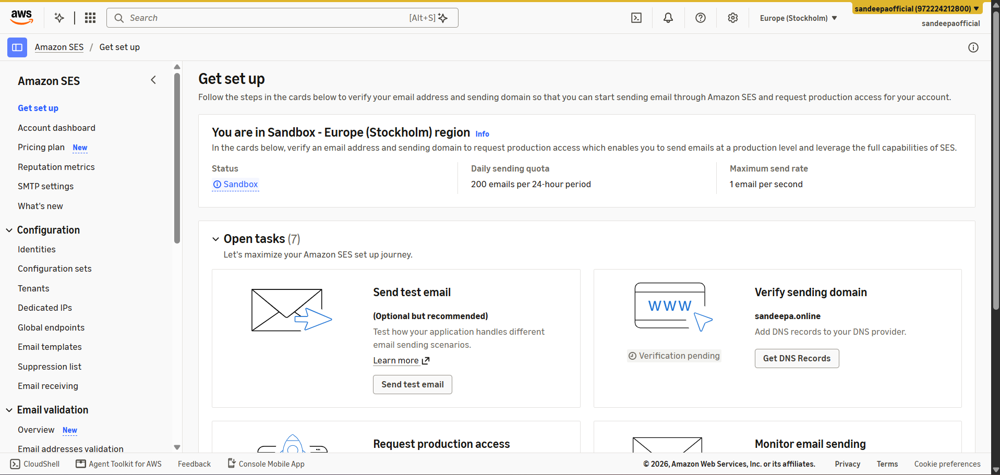

#### Email Identity Verification Confirmation

Confirmation banner confirming successful verification of the sender/recipient email address identity.
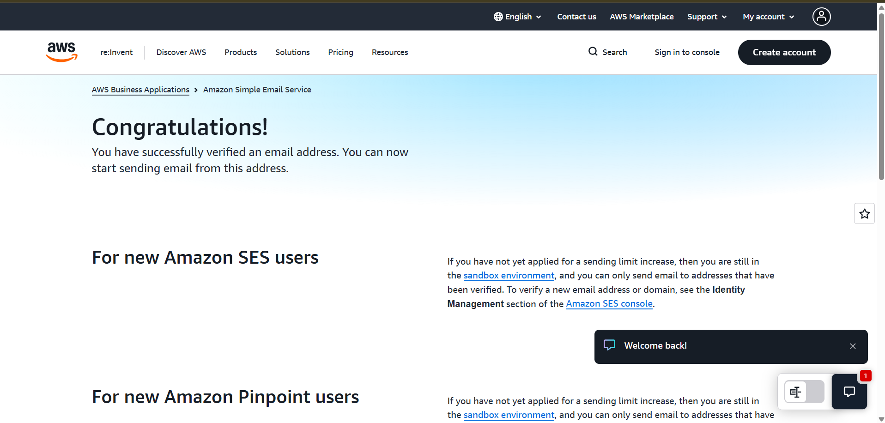

---

### Category 3: IAM Role and Permissions

#### IAM Execution Role Creation

Confirmation banner displaying successful creation of `ContactFormLambdaRole` with Lambda trusted entity (`lambda.amazonaws.com`).
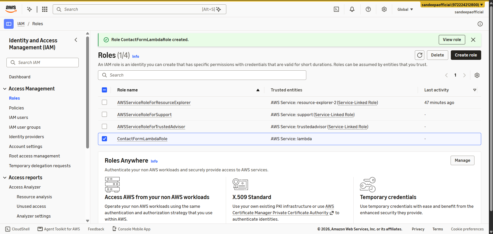

#### Attached IAM Policies

Displays the policies attached to `ContactFormLambdaRole`: the AWS-managed `AWSLambdaBasicExecutionRole` policy for CloudWatch logging and the custom inline `SESSendPolicy` for SES delivery.
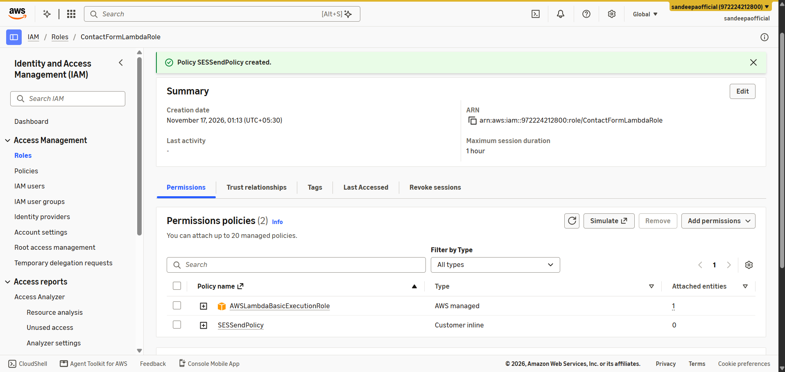

---

### Category 4: Lambda Function Configuration & Code Deployment

#### Lambda Function Overview

Displays `ContactFormHandler` function created in `eu-north-1` with 128 MB configured memory and assigned role ARN.
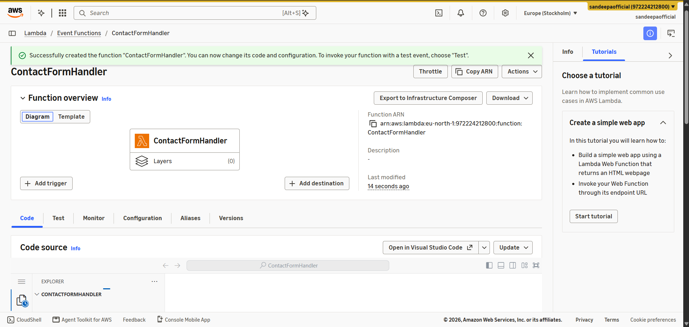

#### Lambda Source Code Editor

Built-in code editor displaying the handler logic, input sanitation (`escapeHtml`), and SES command execution before deployment.
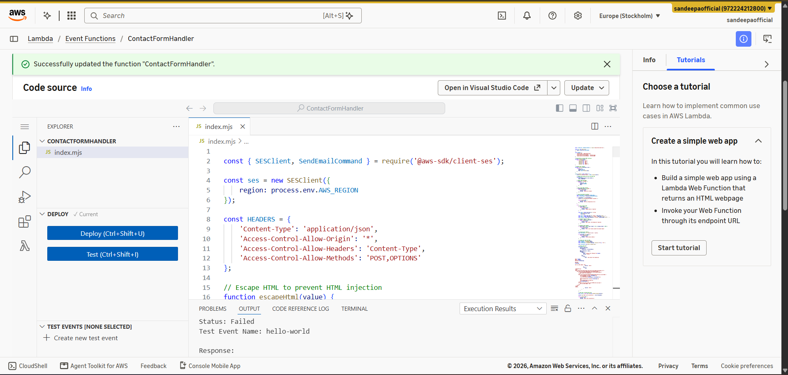

#### Lambda Test Execution & Exception Handling

Executing function test event (`hello-world`) returning structured JSON error handling (`statusCode: 500`) when invoked without required payload properties.
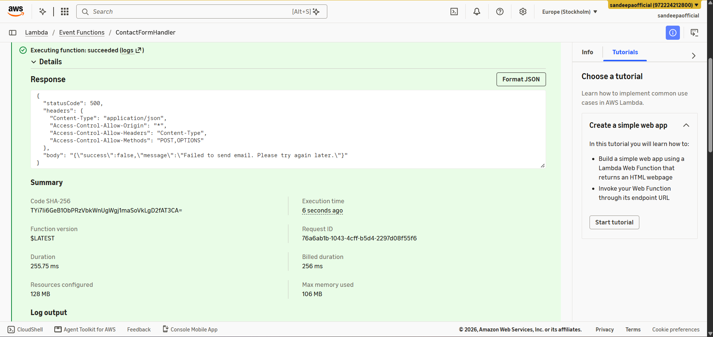

---

### Category 5: Lambda Environment Variables

#### Configured Environment Variables

Displays secure storage of `SENDER_EMAIL` and `RECIPIENT_EMAIL` encrypted at rest with the default AWS Key Management Service (KMS) Lambda key.
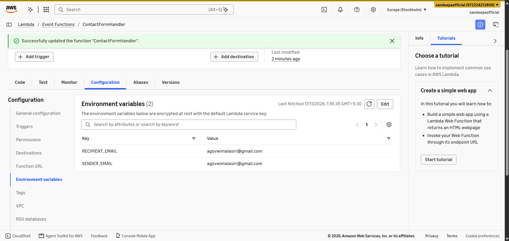

---

### Category 6: API Gateway Configuration & Resource Definition

#### API Gateway REST API Creation

Confirmation banner indicating creation of REST API `ContactFormAPI` with API ID `jw0o1ts2t2` in region `eu-north-1`.
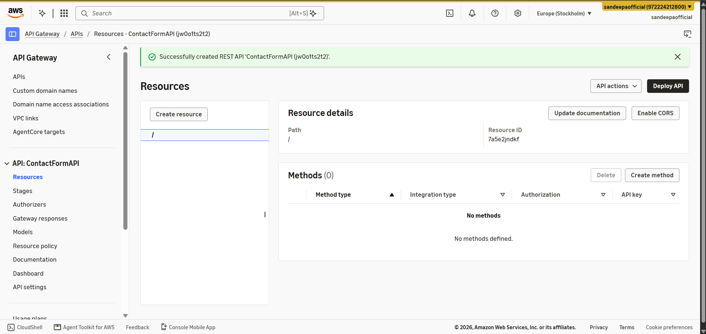

#### `/contact` Resource Creation

Confirmation showing resource creation under root path: `/contact` (Resource ID: `rgmghx`).
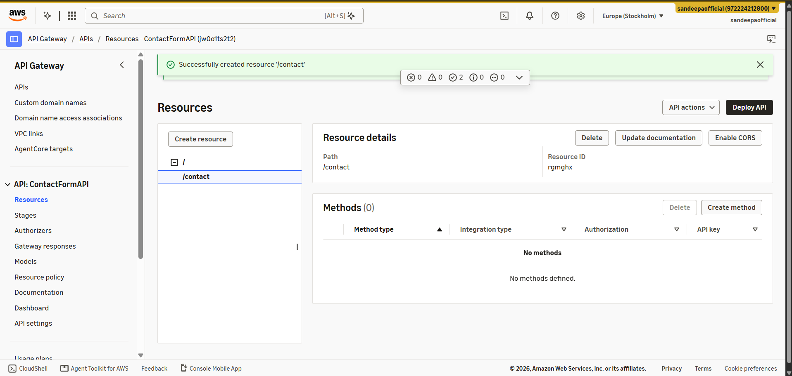

---

### Category 7: POST Method & Lambda Proxy Integration

#### POST Method Execution Diagram

Detailed integration flow diagram showing Client -> Method Request -> Integration Request (Lambda Proxy) -> `ContactFormHandler` -> Integration Response -> Method Response -> Client.
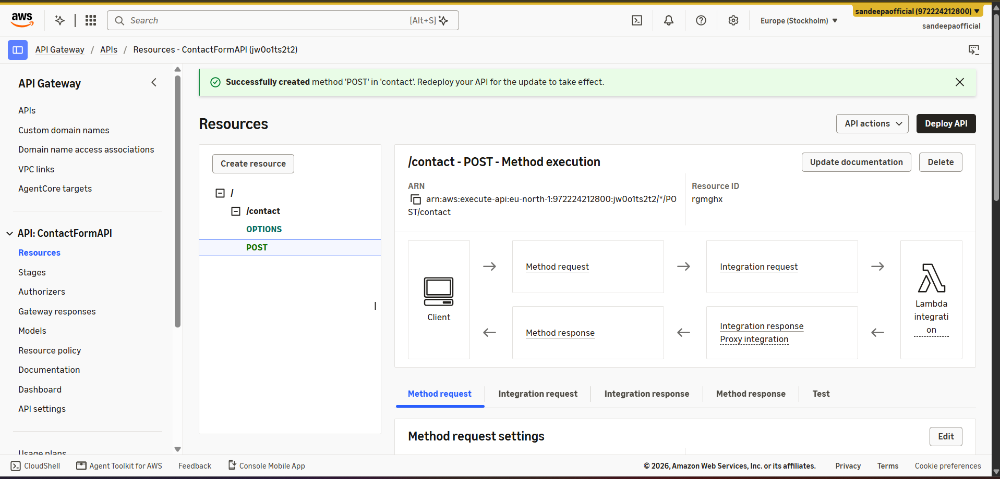

---

### Category 8: CORS Configuration

#### Resources & CORS Preflight Overview

Displays both `OPTIONS` (Mock preflight integration) and `POST` (Lambda proxy integration) methods configured under `/contact`.
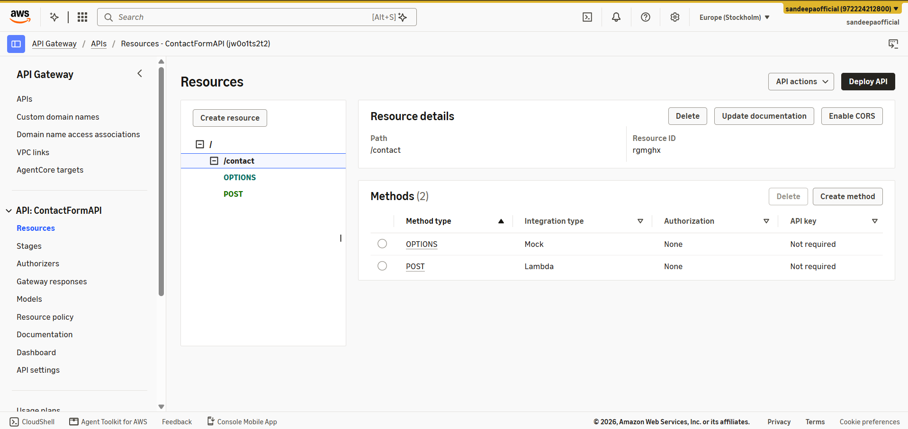

---

### Category 9: API Gateway Stage Deployment

#### Production Stage Deployment & Invoke URL

Deployment details for stage `prod` with active deployment ID `s7sw79` and base Invoke URL `https://jw0o1ts2t2.execute-api.eu-north-1.amazonaws.com/prod`.
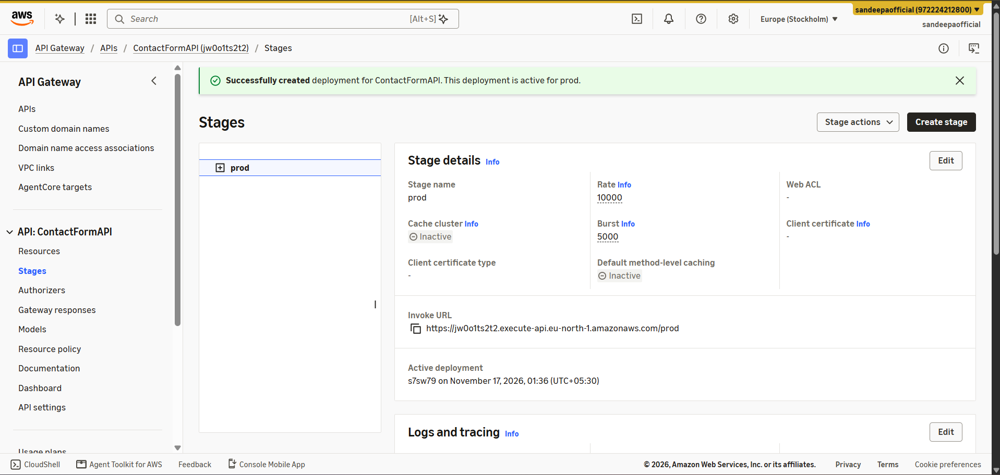

---

### Category 10: Frontend Contact Form

#### Populated Client Form UI

Frontend contact form interface in `contact.html` populated with user details (Sandeepa Wimalasiri) ready for submission.
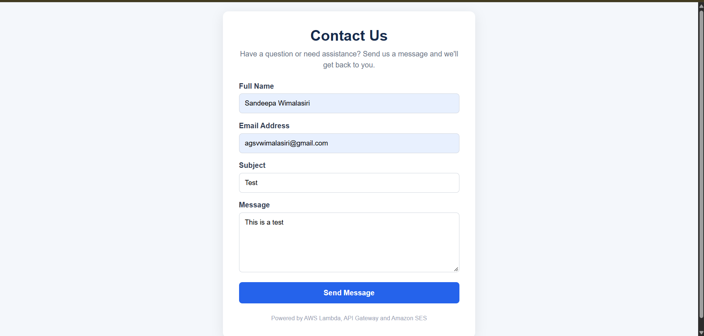

---

### Category 11: Email Delivery Confirmation

#### Gmail Inbox Delivery Evidence

Real email delivered to Gmail inbox via `amazonses.com` displaying HTML card formatting, submission metadata, and message body.
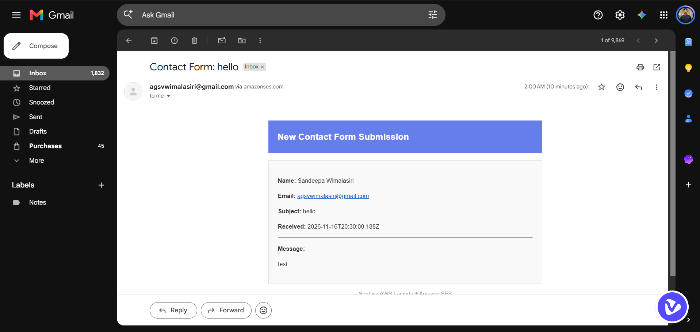

---

### Category 12: CloudWatch Monitoring & Metrics

#### CloudWatch Performance Metrics

Telemetry graphs showing Invocations (sum: 5), execution duration (Avg: 442 ms), and 100% success rate recovery.
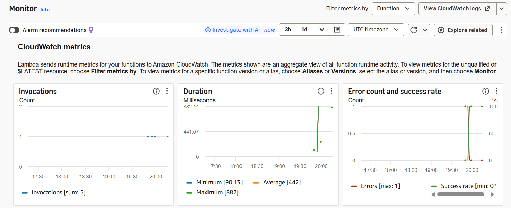

---

## 14. Troubleshooting

| Issue                                                              | Potential Cause                                                                                 | Solution                                                                                                                                                                                          |
| :----------------------------------------------------------------- | :---------------------------------------------------------------------------------------------- | :------------------------------------------------------------------------------------------------------------------------------------------------------------------------------------------------ |
| **CORS Error in Browser** (`Cross-Origin Request Blocked`) | Missing CORS headers in Lambda response or missing `OPTIONS` preflight method in API Gateway. | 1. Ensure `OPTIONS` method is enabled on `/contact`.2. Confirm Lambda returns `'Access-Control-Allow-Origin': '*'` in the `headers` object of **both** success and error responses. |
| **HTTP 500: "Failed to send email"**                         | Lambda missing IAM permissions to invoke Amazon SES.                                            | Check that `ContactFormLambdaRole` has `SESSendPolicy` granting `ses:SendEmail` on the target identity resource.                                                                            |
| **SES Sandbox Rejection: "Email address is not verified"**   | Recipient or sender address is unverified while account is in SES Sandbox.                      | In SES Sandbox, **both** sender and recipient addresses must be verified identities. Verify both or request production access.                                                              |
| **Missing Environment Variables**                            | `SENDER_EMAIL` or `RECIPIENT_EMAIL` not set in Lambda configuration.                        | Navigate to Lambda > Configuration > Environment variables, and ensure both keys exist with valid verified email addresses.                                                                       |
| **404 Resource Not Found**                                   | Incorrect endpoint path requested by client.                                                    | Ensure the URL includes both stage and resource path: `https://<api-id>.execute-api.<region>.amazonaws.com/prod/contact`.                                                                       |
| **403 Forbidden**                                            | API deployed without permissions or incorrect API Gateway URL.                                  | Ensure the API Gateway was redeployed to the `prod` stage after creating or modifying methods.                                                                                                  |

---

## 15. Security Considerations

When moving from a prototype sandbox environment to enterprise production, implement the following best practices:

1. **Amazon SES Sandbox vs. Production Access**:
   - The SES sandbox protects internet reputation by restricting outgoing emails to verified addresses only.
   - For public-facing production forms receiving arbitrary visitor inquiries, submit an **SES Production Access Request** in the AWS Console detailing use case, bounce-handling mechanisms, and spam prevention.
2. **Strict CORS Policy**:
   - In production, replace the wildcard header `'Access-Control-Allow-Origin': '*'` with your specific frontend domain (e.g., `'Access-Control-Allow-Origin': 'https://example.com'`).
3. **Input Sanitization & Injection Prevention**:
   - The Lambda handler incorporates HTML entity escaping (`escapeHtml()`) to mitigate HTML injection in email clients and protect administrative inboxes.
4. **Rate Limiting and Throttling**:
   - API Gateway stage `prod` is configured with a default burst limit of `5,000` requests and a rate limit of `10,000` requests per second. For additional protection against distributed denial of service (DDoS) or form spam, attach an **AWS WAF (Web Application Firewall)** rule set with rate-based blocking.
5. **CAPTCHA Integration**:
   - Integrate Google reCAPTCHA or Cloudflare Turnstile on the client form and validate tokens inside Lambda before dispatching SES calls to prevent bot abuse.
6. **IAM Principle of Least Privilege**:
   - Restrict the `Resource` block in `SESSendPolicy` from `"Resource": "*"` to specific identity ARNs:
     ```json
     "Resource": "arn:aws:ses:eu-north-1:972224212800:identity/agsvwimalasiri@gmail.com"
     ```

---

## 16. Cleanup Instructions

To prevent ongoing AWS Free Tier consumption or accidental billing when you have finished testing the project, delete all provisioned resources using the AWS CLI or Management Console:

### 1. Delete API Gateway

```bash
aws logs tail /aws/lambda/ContactFormHandler --follow
aws apigateway delete-rest-api \
  --rest-api-id jw0o1ts2t2 \
  --region eu-north-1
```

## Cleanup

### 2. Delete Lambda Function

```bash
aws lambda delete-function \
  --function-name ContactFormHandler \
  --region eu-north-1
```

### 3. Remove IAM Role & Policies

```bash
aws apigateway delete-rest-api --rest-api-id $API_ID
aws lambda delete-function --function-name ContactFormHandler
aws iam delete-role-policy --role-name ContactFormLambdaRole --policy-name SESSendPolicy
# Delete inline policy
aws iam delete-role-policy \
  --role-name ContactFormLambdaRole \
  --policy-name SESSendPolicy

# Detach managed execution role
aws iam detach-role-policy \
  --role-name ContactFormLambdaRole \
  --policy-arn arn:aws:iam::aws:policy/service-role/AWSLambdaBasicExecutionRole
aws iam delete-role --role-name ContactFormLambdaRole
aws ses delete-identity --identity you@example.com
rm -f lambda-trust-policy.json ses-send-policy.json function.zip

# Delete role
aws iam delete-role \
  --role-name ContactFormLambdaRole
```

## Learning Objectives

### 4. Remove SES Verified Identities (Optional)

```bash
aws ses delete-identity \
  --identity agsvwimalasiri@gmail.com \
  --region eu-north-1
```

After completing this project, you will understand:

### 5. Delete CloudWatch Log Group

```bash
aws logs delete-log-group \
  --log-group-name /aws/lambda/ContactFormHandler \
  --region eu-north-1
```

- Building serverless applications with AWS Lambda
- Integrating Lambda with API Gateway
- Sending emails programmatically with Amazon SES
- Creating IAM roles with least-privilege permissions for Lambda
- Configuring CORS for cross-origin API requests
- Connecting a static HTML frontend to a serverless backend
- Troubleshooting Lambda failures with CloudWatch Logs

---

## Troubleshooting

## 17. Learning Outcomes

| Problem                                                                                               | Solution                                                                              |
| ----------------------------------------------------------------------------------------------------- | ------------------------------------------------------------------------------------- |
| Email not delivered                                                                                   | Confirm the SES identity is verified and you are in the correct region                |
| CORS error in browser                                                                                 | Verify the OPTIONS method and its integration response headers are configured         |
| Lambda permission error                                                                               | Check that the IAM role has `ses:SendEmail` and `ses:SendRawEmail`                |
| Lambda invocation fails                                                                               | Inspect the CloudWatch log group `/aws/lambda/ContactFormHandler`                   |
| Form shows "Demo Mode"                                                                                | Replace `YOUR_API_GATEWAY_ENDPOINT_HERE` in `contact.html` with the real endpoint |
| Through completing this project, the following core cloud engineering competencies were demonstrated: |                                                                                       |

- **Serverless Architecture Design**: Architecting and orchestrating decoupled, event-driven web backends without dedicated server infrastructure.
- **API Management**: Implementing RESTful interfaces in Amazon API Gateway, handling CORS preflight handshakes, and configuring Lambda proxy integrations.
- **Event-Driven Compute**: Writing production-ready asynchronous Node.js functions with input validation, error handling, and AWS SDK v3 service clients.
- **Email Service Integration**: Configuring transactional email infrastructure using Amazon SES, managing sandbox limitations, and handling identity verification.
- **Identity & Access Management (IAM)**: Crafting least-privilege IAM policies, managing trust relationships, and securing serverless executions.
- **Operational Observability**: Monitoring distributed serverless invocations, identifying performance bottlenecks, and troubleshooting cold starts through Amazon CloudWatch metrics and logs.

---

## 18. Author Information

**Sandeepa Wimalasiri***AWS Cloud & DevOps Enthusiast*

- **AWS Region**: `eu-north-1` (Stockholm)
- **GitHub**: [github.com/SandeepaWimalasiri](https://github.com/) *(or link your personal profile)*
- **LinkedIn**: [linkedin.com/in/sandeepa-wimalasiri](https://www.linkedin.com/)

---

*This project is part of the AWS Cloud Engineering Project Portfolio series.*
